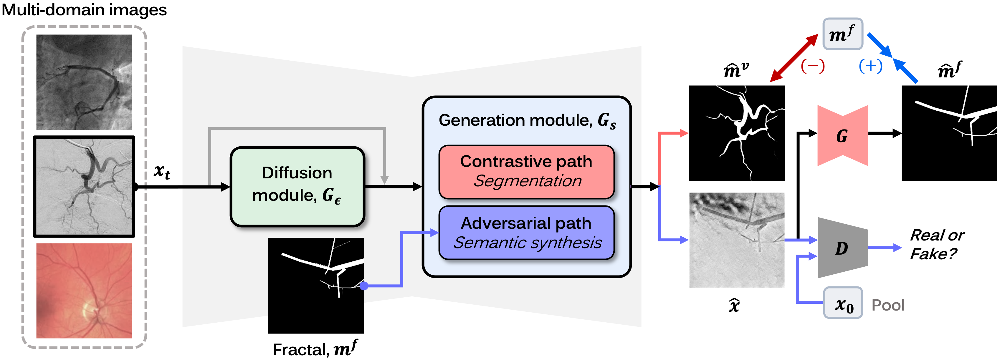

# MEDIA_CDARL

本仓库基于论文 *C-DARL: Contrastive diffusion adversarial representation learning for label-free blood vessel segmentation*（Medical Image Analysis, 2024）的官方实现，用于无标签血管分割，并在此基础上接入了眼底等医学图像上的本地训练流程。

论文：[arXiv](https://arxiv.org/abs/2308.00193) · [Medical Image Analysis](https://www.sciencedirect.com/science/article/pii/S1361841523002827)



## 环境

- 系统：Ubuntu
- Python >= 3.9
- PyTorch >= 1.12.1

## 目录说明

| 路径 | 内容 |
| --- | --- |
| `main.py` | 训练与测试入口 |
| `config/` | 原始 XCAD 配置：`train.json`、`test.json` |
| `model/` `core/` `util/` `data/` | 模型、日志指标、可视化与数据读取 |
| `prepare_*.py` | 把本地数据整理成训练目录 |
| `run_train_*.sh` | 后台启动训练，关闭终端后继续跑 |
| `synthesis_validation.py` `test_synthesis.py` | 用固定时间步做合成效果检查 |
| `KAGGLE_TRAINING.md` | Kaggle 灰度眼底这一轮的训练说明 |
| `scripts/` | 配套脚本 |

以下内容已写入 `.gitignore`，不会上传：

- `data/`、`experiments/`：数据集与训练权重
- `test_input/`、`test_output/`、`test_output_1/`：本地测试图
- `logs/`、`logs_launch/`：训练日志
- `*.png` 等图片。方法示意图 `fig/method.png` 除外，会随仓库上传

## 数据

原始实验使用公开的 XCAD 数据集，说明见论文。数据请自行下载，放到 `./data/Dataset_XCAD/`，不要提交到本仓库。

作者提供的 XCAD 预训练权重：[Google Drive](https://drive.google.com/file/d/180xRhnpAsT6ZrM-FrMTZ6AVkqnfBBqYm/view?usp=sharing)。下载后放到 `./experiments/pretrained_model`，再用下面的测试命令检查。

## 原始 XCAD 训练与测试

训练：

```bash
python3 main.py -p train -c config/train.json
```

测试：

```bash
python3 main.py -p test -c config/test.json
```

## 本地扩展训练

Kaggle 灰度眼底数据的准备、划分、启动方式和合成图检查，见 [KAGGLE_TRAINING.md](KAGGLE_TRAINING.md)。启动示例：

```bash
./run_train_kaggle.sh
tail -f logs_launch/train_kaggle.log
```

另有眼底数据与 EyeQ Q0 子集的准备、启动脚本：`prepare_fundus_data.py`、`prepare_kaggle_eyeq_q0.py`，以及 `run_train_fundus.sh`、`run_train_kaggle_eyeq_q0.sh`。

## 引用

若使用本方法，请引用原文：

```bibtex
@article{kim2024cdarl,
  title = {C-DARL: Contrastive diffusion adversarial representation learning for label-free blood vessel segmentation},
  journal = {Medical Image Analysis},
  volume = {91},
  pages = {103022},
  year = {2024},
  issn = {1361-8415},
  doi = {https://doi.org/10.1016/j.media.2023.103022},
  author = {Boah Kim and Yujin Oh and Bradford J. Wood and Ronald M. Summers and Jong Chul Ye}
}
```
