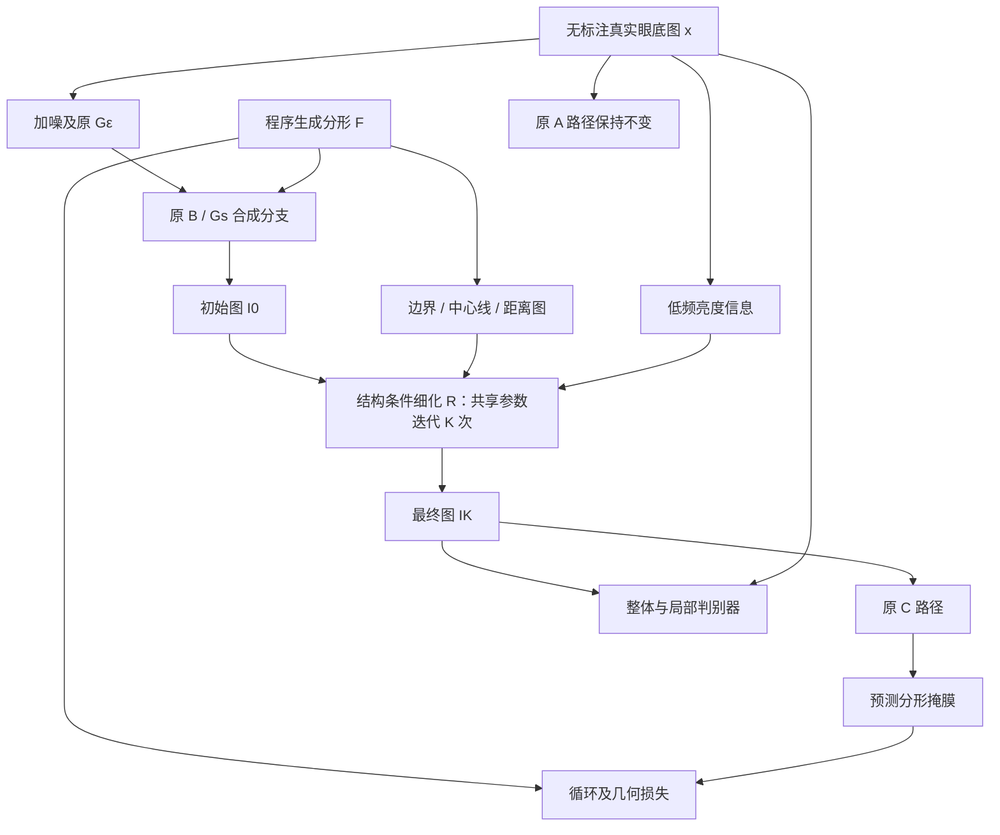

# C-DARL B 路径合成改造方案：无标注、多步结构条件细化

- 日期：2026-11-15。
- 状态：方案草案，待用户同意；本次只新增此文档，不修改训练/推理代码，不启动训练。
- 目标：重点提高 B 路径合成眼底图像的真实性和血管结构可控性，再验证改进的合成图是否帮助 C 路径及真实图像分割。
- 数据约束：沿用无人工血管标注训练，只使用真实眼底图像与程序生成的分形掩膜。
- 改动范围：保留原 A/C 路径及参数共享关系，在 B 的初始合成器后新增多步细化网络，配套修改条件编码、对抗训练、结构损失、保存和推理接口。
- 方法定位：借鉴 OT-Bridge Editor 的复合结构表示和路径几何指导思想；本方案不是该论文的直接复现，不实现完整熵正则 OT 或 Schrödinger Bridge 求解器。

## 1. 本方案要验证什么

当前 C-DARL 的生成器先结合真实图像信息和分形条件合成图像，再将合成图送入 C 路径进行分割，要求找回输入的分形结构。研究假设是：合成图像若存在模糊血管、不自然背景或可被分割网络利用的伪影，会影响合成域到真实眼底域的迁移。

本方案首先验证“B 是否合成得更真实且服从目标结构”，随后才验证“真实眼底分割是否提升”。二者不能互相替代：合成图更好看、循环 Dice 更高，都不能单独证明真实分割更好。

交付目标分为两级：

1. 主要目标：相同参考图、目标掩膜、噪声和分辨率下，新 B 比原 B 具有更真实的局部纹理、更清晰的目标血管和更少的伪影。
2. 后续目标：有独立真实标注评估时，检验 A 路径的真实图像分割。用户的测试图片在训练后提供，不作为启动训练的前置条件。

## 2. 明确保留和不引入的内容

| 内容 | 处理 |
| --- | --- |
| 真实眼底图像、随机分形掩膜 | 保留，不要求真实图与分形配对 |
| A 路径：真实图像到预测血管 | 保留 |
| C 路径：合成图像到预测分形血管 | 保留，接收细化后的图像 |
| 原 Gε 和 Gs 及 A/C 的共享参数 | 尽量复用已有结构和权重 |
| B 的原合成输出 | 保留为初始图 I0，同时作为对照输出 |
| 分割教师、真实图离线伪标签 | 不引入 |
| 额外的预训练眼底分割模型 | 不引入 |
| 用20例人工血管标注训练生成器 | 不采用 |
| 完整 OT/SB、从纯噪声仅凭掩膜生成 | 不在首版范围 |
| 灰度改彩色 | 不在首版范围，仍输出单通道灰度 |

原 C-DARL 的分割网络在训练中继续学习，不被替换为外部教师。短暂冻结原模块只用于新模块接入初期稳定训练，不产生伪标签数据，也不进行教师自训练循环。

## 3. 当前代码事实与需要隔离的问题

依据本地代码检查，实施时应先锁定实际运行版本、配置和权重，不能把历史说明当作当前远端运行状态。

| 位置 | 当前行为 | 新方案的处理 |
| --- | --- | --- |
| `model/ddpm_modules/diffusion_seg.py::p_losses` | B 接收加噪真实图、Gε 输出和条件；C 对合成图分割 | 保留入口，在初始合成与 C 之间接入细化网络 |
| 同上 | 有 `C` 就用它合成，但循环目标仍为 `F` | 新实验禁用真实图提取的4通道 `C`；所有结构条件由本次 `F` 派生 |
| `model/model.py::optimize_parameters` | 对比头以 F 为查询，预测掩膜为正/负例 | 保留现状，不把对比实现修改混入本次实验 |
| `model/ddpm_modules/loss.py::MaskPatchNCELoss` | 正、负预测特征均 `detach()` | 如实记录：该项直接更新 H，不会沿预测掩膜分支更新 G；不得将它当作新增几何监督 |
| `model/model.py::_perceptual_loss` | 对合成图和不配对真实图做逐位置 VGG 特征比较 | 新实验关闭 `lambda_perc`，避免强迫随机分形还原另一套血管结构 |
| `data/XCAD_dataset.py` | 已支持完整眼底预处理，也支持读取旧的图像派生条件 | 新实验不读取旧 `conditions/`，统一从本次分形计算几何条件 |
| `synthesis_validation.py` | 实际使用参考原图加噪，不是仅凭掩膜生成 | 新测试明确记录参考图，并与训练共用 B 的合成函数 |
| `main.py` | 训练期间默认依赖 `test_input` 做合成监测 | 新实验使用内部无标注监测集；用户最终测试图片可稍后提供 |

已有“生成质量跃升方案.md”中的 black-hat 伪血管条件、视盘条件和4通道 jump 路线不作为本方案的数据前提。旧实验保留作历史对比，不覆盖其文件或输出。

## 4. 数据在哪里使用

### 4.1 三类数据

| 数据 | 用在哪里 | 是否训练目标 |
| --- | --- | --- |
| Kaggle 真实眼底图像，约3万张 | 原扩散噪声预测；B 的外观来源；真实图判别样本 | 真实图分布目标，不是随机分形的配对真图 |
| 程序生成的分形掩膜 F | B 与细化网络的结构条件；C 的循环/几何目标 | 已知的目标几何，不是原眼底图标注 |
| 训练后用户提供的伪标签和参考图 | 最终合成测试 | 不回流到本轮训练 |

真实图像与分形是独立的。真实图像教网络“眼底外观应该是什么分布”，分形掩膜教网络“这次应生成什么血管布局”。

禁止把合成图与不配对真实图做全图像素 L1/L2 或逐位置感知重建。也不直接照搬“血管区域外全部复制参考原图”：原图自身的血管可能不属于目标分形，硬复制会残留原血管。

### 4.2 划分和预处理

1. 根据现有 manifest 划分训练集与内部无标注监测集，监测样本不参与梯度更新；若文件名可以识别同一受试者的双眼，按受试者分组。
2. 监测集可先取16张真实图、固定16张分形和固定种子，形成固定参考图/分形组合。保存清单和哈希，不使用用户尚未提供的最终测试图片。
3. 保持目前真实图质量采样策略不变，不同时以改变数据质量分布作为主要改进来源。
4. 首选384×384、batch=1，保持完整眼底视野；先测显存再决定512。新旧主对照必须使用相同分辨率。若显存不足可统一降为256做接入验证，不能拿分辨率变化冒充细化收益。
5. 真实图和分形均规范化；F 先转换为0/1二值几何，再计算中心线、边界和距离。C 的循环目标继续使用原范围 [-1,1] 的 F。
6. 对 F 的缩放采用最近邻；随机增强后再派生几何条件，保证所有几何通道与循环目标严格一致。
7. 训练分形应位于有效视野内，记录原分形与有效目标 F 的处理过程。不得悄悄裁掉用户测试掩膜中的细支来改善指标。
8. 图像预处理的裁剪、填充、缩放矩阵必须保存。对应原图/掩膜测试时共用变换；独立参考图模式下，目标掩膜按其完整坐标域映射，禁止按血管包围盒自动放大。

## 5. B 的新结构

### 5.1 总体流程



### 5.2 复合结构条件

几何编码为4通道：

`Cf = concat(F_binary, boundary(F), skeleton(F), signed_distance(F))`

- 掩膜：目标血管占据区域。
- 边界：用固定的小邻域形态学算子计算，表达管壁位置。
- 中心线：从分形几何计算，不从真实图中预测；断支和交叉处不做人为连接。
- 有符号距离图：统一正负号约定，截断并缩放到 [-1,1]；默认截断半径16像素，随分辨率等比例调整。

空掩膜、极细掩膜、全前景必须有确定输出，距离图不得出现 Inf/NaN。几何提取可用规则算法，不涉及训练新的分割器。计算较慢时可预计算，但应用几何增强后需保证距离与骨架含义一致，不能随意插值后直接当真值。

为兼容原权重，原 Gs 合成器仍使用原2通道 one-hot 分形条件；新的4通道几何输入先只进入 R。避免将原 Gs 改成4条件通道而导致旧权重失配。

### 5.3 细化网络 R

首版使用轻量 U-Net：基础通道32，两次下采样，具备跳跃连接；输出单通道残差。最终结构和参数量需在实现时记录。

每一步输入包含：

`[当前图 Ik, 初始图 I0, 参考图低频亮度 x_low, Cf, 步骤编码]`

合计8通道，其中步骤编码为与图像同尺寸的归一化常数图。Cf 在编码/解码的多个分辨率注入，避免细化过程忽略目标几何。参考图低频信息只提供照明和大范围外观，不直接向 R 传原图高频边缘作为需要复制的目标。

- 默认 K=3，三步共享 R 参数，不堆叠三套独立网络。
- 首次卷积/输出头设计支持零残差初始化，使接入时最终图近似原始 I0。
- 在 logit 空间执行有界残差更新：`u0=atanh(clamp(I0))`，`u(k+1)=uk+alpha*tanh(R(...))`，`I(k+1)=tanh(u(k+1))`。
- alpha 初值建议0.1；这是接入起点，不是声称已找到最优超参数。
- 同时保留 I0、I1、I2、I3，便于判断细化是否真的改善，而不是多走一步就更差。
- 训练时不得 detach 中间图，否则路径损失无法训练前面的细化步骤。

这是一套学习式多步图像细化过程，不是将扩散时间 t 重复调用几次，也不称为 SB 采样。原扩散时间 t 与细化步骤 k 是两种不同索引。

## 6. 损失和梯度

### 6.1 保留的目标

- 原真实图噪声预测损失 `L_diff`。
- 最终合成图经 C 路径得到预测，与输入 F 比较的循环 L1 损失 `L_cycle`。
- 原有对比头 H 和对比项的实现保持一致，不将修改 detach 行为混入本轮改造。
- 整体图像的 LSGAN 对抗目标。

### 6.2 新增的目标

1. **局部真实性**：新增局部 PatchGAN，比较真实/合成眼底的局部纹理。每图默认2个128×128有效视野内随机块，真实与合成采用一致采样规则。不能只从合成图的目标血管附近取块、却从真实图随机取背景块，造成分布偏差。
2. **最终几何**：复用 C 的预测，转成软概率 `p=(m_pred+1)/2`，与 F 计算 soft Dice 及软边界一致性。边界用可微的软形态学梯度计算，不使用阈值、NumPy 或硬骨架截断训练梯度。
3. **路径几何**：从非最终细化步骤中抽取一步，运行同一个 C，计算相同几何项。控制中间步骤权重，先允许形成外观，再逐步加强结构；不能强求每一步都达到最终图质量。
4. **soft-clDice**：作为后续结构消融项，默认关闭；先确认新增边界/Dice和细化本身有效，再单独检验连接性约束，避免首轮同时混入过多变量。

以上均不需要真实眼底血管标注，几何目标始终是本次输入的分形。C 本身会有误差，甚至与生成器共同利用伪影，因此循环/几何分数只是内部一致性证据，必须配合图像检查和独立测试。

### 6.3 首轮起始权重

各损失先按样本及有效像素/patch均值归一化，不能把 sum 与 mean 的尺度混用。下面是待短跑校准的起点，不是已验证最优值。

| 项 | 初始系数 | 说明 |
| --- | ---: | --- |
| L_diff | 1.0 | 保持原噪声训练 |
| L_cycle | 2.0 | 保持原循环主约束 |
| 整体 G 对抗损失 | 0.2 | 与原量级对齐 |
| 局部 G 对抗损失 | 0.05 | 首轮较弱，避免只锐化伪影 |
| 最终 soft Dice | 0.2 | 在新细化输出上计算 |
| 最终软边界项 | 0.05 | 边界归一化后计算 |
| 中间几何项 | 最终几何项的0.25 | 默认每批抽取一个非最终步骤 |
| 原 NCE | 沿用基线配置 | 明确其当前梯度只直接更新 H |
| 逐位置 VGG 感知损失 | 0 | 不配对场景下不使用 |
| 旧 appearance 四项 | 0 | 不与本轮机制叠加 |

每次短跑记录原始损失、加权损失及新增模块梯度。调整依据包含梯度范数与图像变化，不能只要求不同损失数值相等。

### 6.4 梯度路径

- 更新判别器：合成图 detach，不更新 G/R。
- 更新生成网络：固定判别器参数，但保留对输入图像的梯度。
- C 上的循环/几何损失：反向经过 C 和细化输出，更新 R；联合训练时也更新原 Gε/Gs。
- 新的几何项不能照搬 NCE 中的 detach：必须检查从几何损失到 R 的梯度非零。
- 中间 C 调用复用参数，不创建独立分割器。为节省开销，第一版每批只增加一个中间 C 调用，而非每一步都做完整 C。

## 7. 代码改动清单

以下均为用户同意后的计划，当前尚未实施。

| 文件 | 计划改动 |
| --- | --- |
| 新增 `model/refinement.py` | 实现共享步骤的结构条件细化 U-Net 和零残差初始化 |
| 新增 `data/geometry.py` | 统一计算分形/测试掩膜的边界、中心线、距离图；处理空掩膜 |
| `data/XCAD_dataset.py`、`data/__init__.py` | 新配置下禁用旧 conditions；保证 F、几何通道、循环目标同步；支持内部监测划分 |
| `model/networks.py` | 按配置创建 R；保留原 Gε/Gs 结构；添加整体/局部判别器入口 |
| `model/ddpm_modules/diffusion_seg.py` | 新增统一 `synthesize()`，返回初始/中间/最终图；B 在此调用，C 使用最终图；保留旧模式 |
| `model/ddpm_modules/loss.py` | 增加 soft Dice 和可微边界项；不改原 NCE 的梯度定义 |
| `model/discriminators.py` | 增加局部判别器及均值化 patch 对抗接口 |
| `model/model.py` | 新模块优化器、分阶段训练、几何/局部对抗损失、日志、断点保存和迁移加载 |
| `main.py` | 支持内部监测样本，不依赖最终 `test_input`；记录训练阶段；到上限保存最终状态 |
| `synthesis_validation.py` | 统一调用 `synthesize()`，导出逐步图、条件敏感性结果、耗时和元数据 |
| 新增 `test_refinement.py` | 参考图＋目标掩膜的明确测试入口；兼容批量清单 |
| 新增 `config/train_kaggle_refine_v1.json` | 独立实验配置；不覆盖已有配置 |
| 新增 `run_train_refine_v1.sh` | 明确配置、GPU和日志；在实际训练主机上启动与恢复 |
| `TRAINING.md` | 实施完成后记录真实启动命令、权重来源、阶段与结果，不预写虚构结果 |

旧输出 tuple/调用接口如需调整，应逐处更新初始化、可视化、验证调用；优先通过额外字典提供 refinement 信息，不能只改 p_losses 而让既有训练入口失效。

## 8. 旧权重兼容和训练阶段

### 8.1 先核实，不猜权重

当前本地代码不包含可验证的训练主机状态，历史文档中的 `I110000_E5` 等只作为候选线索。实施时需在实际训练位置核实配置、权重文件、哈希、参数键和形状，选择原2通道条件、无 C/F 冲突的已训练模型作起点。

若没有可用兼容权重，先运行原无标注训练获得基线，再做接入；不能声称已加载实际上不存在的权重，也不能无声跳过大量不匹配层。

- **迁移初始化**：加载匹配的原 Gε/Gs/H 权重，R 新初始化；新建优化器和新实验计数。
- **断点恢复**：只针对同架构的新实验，完整恢复所有模型、优化器、阶段、计数及随机状态。
- 新旧优化器参数集合不同，不能拿旧 resume_state 直接恢复新网络。
- 若256提升到384，检查 UNet 注意力所在层。保持模块图一致，必要时按层映射注意力分辨率（例如16对应24），不能只改 image_size 导致注意力层消失或错位后仍假称完整复用。

### 8.2 建议训练流程

| 阶段 | 范围 | 更新什么 | 目的 |
| --- | --- | --- | --- |
| 接入检查 | 少量 batch，不计作效果训练 | 无或最少更新 | 检查形状、梯度、保存、有效视野、显存及逐步输出 |
| 新模块预热 | 约2000 step | R、整体/局部 D；原 Gε/Gs 暂不更新 | 防止随机新模块立即破坏已有网络，确认细化能受约束 |
| 联合微调 | 约18000 step | 原 Gε/Gs、R、H及判别器 | 在原无标注循环中共同适应新的合成图 |
| 后续延长 | 依据收敛、资源与效果另行确定预算 | 同联合阶段 | 20k 是首轮试验上限，不等于保证收敛或保证最终最优 |

预热时 C 仍是原网络。虽然暂不更新其参数，也必须允许梯度穿过其运算回到生成图/R，不使用 no_grad 包住 C。这是新模块接入的短暂优化安排，不是伪标签教师训练。

预热先使用最终循环/几何项；中间路径项在联合阶段逐步启用，避免一开始所有约束叠加。记录各阶段启用项和有效系数。

每1000 step保存状态和固定监测结果；最近完整恢复点至少保留3组，阶段边界与里程碑权重单独保留。保存文件集合必须包含 R、局部 D、对应优化器和阶段信息，不能只沿用旧六文件格式漏掉新状态。

正式长训前测实际每步时间、峰值显存，再估算耗时。不沿用过去256实验的时长承诺，也不预设当前GPU可用。

## 9. 测试接口：训练后再提供图片即可

### 9.1 输入与边界

本次模型实际需要“目标掩膜＋参考眼底图＋随机种子/噪声级别”。允许在界面或脚本中固定参考图，只上传目标掩膜，但必须在元数据中记录内部使用了哪张参考图。

本次不承诺模型内部完全不使用参考图的 mask-only 生成。也不承诺恢复伪标签对应的唯一原始照片：掩膜不包含完整背景、颜色和病灶信息。

测试支持两类模式：

1. **对应参考**：目标掩膜来自同一张参考图；检查重建式合成质量，但不能据此排除复制原图的捷径。
2. **独立参考**：目标掩膜与另一张真实参考图组合；检查模型是否服从结构而不是保留参考图血管。

掩膜约定为单通道0/255或0/1、血管为前景；支持概率图时显式记录阈值，不能自动猜测极性。统一几何处理，测试时不做额外平滑、补支来美化结果。

### 9.2 计划命令形式

以下为拟实现接口，并非当前已经可运行的命令：

```bash
python test_refinement.py \
  --config config/train_kaggle_refine_v1.json \
  --weight <new_checkpoint_prefix> \
  --reference_dir <reference_images> \
  --mask_dir <target_masks> \
  --output_dir <new_result_directory> \
  --seed 2026 \
  --timesteps 200 800 1600 \
  --refine_steps 3
```

批量参考/掩膜关系应通过 manifest 明确指定，不能仅依赖文件排序隐式配对。三个 t 是参考图加噪水平，不是三步细化索引；每个 t 下均运行 K 次 R。

### 9.3 每个测试组合的输出

- 参考图、原始目标掩膜及经过坐标变换后的有效掩膜。
- 复合几何条件的可视化。
- I0、I1、I2、I3及放大局部对照。
- 使用同一初始权重/输入约定的原 B 对照，并标明基线是否单独微调过。
- 最终图经 C 的预测以及循环一致性分数，明确标注为内部诊断指标。
- JSON元数据：输入哈希、权重哈希、分辨率、坐标变换、噪声级别、随机种子、步骤、配置、设备、耗时。
- 无原图直方图匹配、无低频替换后处理。若以后增加诊断后处理，必须单独保存，不能替代原始输出。

## 10. 如何判断这次改造有没有价值

### 10.1 首先看合成

固定参考图和噪声，对同一掩膜比较原 B、I0、最终图；还必须固定参考图更换掩膜，和固定掩膜更换参考图。

观察：

- 细血管是否可辨，是否出现一片灰带、重复纹理、光晕、断裂或不自然锐化。
- 分叉、管径和位置是否跟随掩膜，还是复制参考图中的旧血管。
- 视盘、眼底背景和视野边界是否自然；新细化是否破坏原先较好的区域。
- 从 I0 到后续步骤是否有一致改善，还是只有循环分数提升。

对真实/合成分布可报告 KID/FID 等探索性指标，但16张监测样本不足以支撑可靠结论。大样本分布比较须保持参考图、条件和样本数一致，且说明自然图像特征用于眼底图像的局限。平均亮度接近不作为主要成功证据。

循环 Dice、soft Dice、边界项均依赖训练中的 C，不是独立结构准确率。特别关注视觉图不变但循环分数大幅上升的情形，避免共同利用伪影。

### 10.2 再看分割迁移

训练后若用户提供独立人工标注，冻结评估协议后比较原/新模型 A 路径的真实图像 Dice、Recall、Precision与连接性表现。若只有伪标签，则只能评估对输入条件的遵循程度，不能将其当作人工真值声称分割准确率提高。

20例若用于频繁选择模型或系数，应明确记为验证数据；不能再作为同一轮最终独立测试结果。训练阶段默认不使用其人工标注。

### 10.3 对照设计

建议按以下层次分离贡献，不默认同时启动四组长训：

| 组别 | 改动 | 要回答的问题 |
| --- | --- | --- |
| G0 | 匹配数据、分辨率、基础损失的原 B | 基线是什么 |
| G1 | 原 B＋R＋局部真实性；保留原循环 | 新合成结构是否有效 |
| G2 | G1＋最终软边界/Dice | 结构约束是否帮助外观与条件遵循 |
| G3 | G2＋中间路径几何 | 逐步约束是否有额外收益 |

首轮先完成接入检查和单组20k试验；关键消融按结果和资源实施。不能只比较旧256模型与新384模型，也不能仅靠同一新模型的 I0/IK 对比推断全部训练收益。联合训练后 I0 本身会变化，需要单独基线支持归因。

如合成外观没有改善、条件敏感性不足、参考图旧血管残留严重或真实分割退化，应回到对应机制定位，不以继续无上限训练替代判断。尚未收敛与机制无效应区分记录。

## 11. 实施时的必要检查

这些是用户同意实施后的检查项，本次仅制定计划。

1. 原模式开关关闭 R 时，输出与同权重旧路径一致；零残差初始化下新路径近似 I0。
2. F 的几何编码与翻转、旋转、缩放严格对应，条件与 C 目标不存在 C/F 冲突。
3. 新增循环/几何项能传梯度至 R；预热阶段原参数不更新，联合阶段恢复；判别器/生成器更新相互隔离。
4. 空掩膜和极细血管不导致 NaN；soft-clDice若启用，正确处理空前景。
5. 训练 B 和测试调用相同 `synthesize()`；固定输入/种子可复现，监测过程不改变训练随机流。
6. 保存后重载产生相同输出，断点恢复包含所有新模块和阶段；历史权重迁移报告列出全部缺失/多余/形状不匹配键。
7. 实测显存、耗时及小批次训练有限值，确认输出尺寸与动态范围。
8. 所有结果进入独立目录，不覆盖旧实验、用户掩膜或原图。

## 12. 用户同意后的执行顺序

1. 核实实际训练位置、可用数据、兼容权重和GPU；记录基线及配置快照。
2. 在保留旧运行模式的前提下新增几何编码、R、局部判别器和统一合成接口。
3. 完成有针对性的梯度、权重兼容、坐标、保存恢复及小批次检查，生成接入对照图。
4. 运行首轮预热与联合训练，使用内部无标注监测集，不要求提前提供用户最终测试图片。
5. 汇报真实训练状态、原始合成图及主要限制，给出可恢复权重和测试命令。
6. 用户随后提供测试参考图/伪标签时，按固定协议生成对照结果；在没有独立真实标注之前，不宣称真实分割已经提升。

## 13. 论文依据与适用边界

- C-DARL: Contrastive diffusion adversarial representation learning for label-free blood vessel segmentation，Medical Image Analysis 91 (2024), 103022。依据其方法、训练损失、合成图示及本地实现保留 A/B/C 无标注训练逻辑。
- Geometrically Constrained Stenosis Editing in Coronary Angiography via Entropic Optimal Transport，用户提供的 OT-Bridge Editor PDF。借鉴第3节复合结构与 GPG 的路径指导思想；其局部编辑、源图保护和配对训练设置不能直接等同于本方案的随机分形眼底合成。
- 本文的 R、局部对抗、复用 C 的软几何损失及分阶段训练，是针对当前代码提出的工程研究方案，尚无本任务实验结果。它不承诺一定改善，也不以新增几个损失冒充完整 OT/SB。

本方案的核心是：在不新增分割教师、不要求人工血管标注的前提下，实质性改造 B 的合成过程，并将“合成改善”和“真实分割改善”分别验证。
