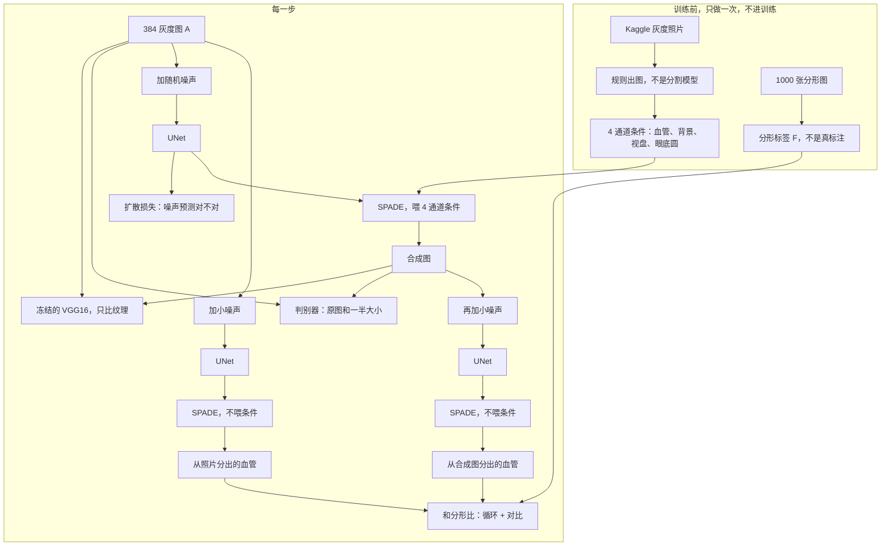

# 生成质量跃升方案

当前最好的结果是 `I110000_E5`。它比全量 10 万 step 的图亮一点，但没有质变：细血管仍糊，视盘是一块白斑，圆盘上沿仍有鼓包。再调抽样权重、再加亮度损失、再续训几千步，都过不了这个上限。

要明显更接近真实眼底图，需要改生成方式。下面四项放在同一次新训练里做。网络主体仍用现有 C-DARL，不先换成另一个模型。

## 为什么现在到头了

合成不是“由 mask 直接生成眼底图”。训练 B 路径是：把真实灰度图加噪，预测噪声，再用 SPADE 生成器按条件把图填回来。

现在有四个和目标不对齐的地方：

- 512 的图被随机隔点抽成 256。细血管在这一步就丢了。
- 训练时的血管条件是 1000 张分形标签，测试时换成真实血管 mask。模型没有按真实血管形状学过生成。
- 条件只有 2 通道 one-hot。没有视盘位置，也没有眼底圆，所以视盘只能糊成白斑，圆边会鼓。
- 损失是扩散 L2、循环 L1、LSGAN 和 MaskPatchNCE。这些能保住粗结构和可分割性，不能逼出照片级纹理。论文优化的是分割 Dice，合成只是辅助分支。

`I110000_E5` 上加的四项小损失（血管对比、圆边、灰度分布、背景纹理）权重大约只有原损失的几十分之一。它们能把亮度拉近一点，不能补分辨率和条件缺失。

## 一次训练里做的四件事

作者原来的扩散损失、循环损失、MaskPatchNCE 先保留。改的是输入分辨率、条件和清晰度损失。

### 1. 不再隔点抽样

现在 `data/XCAD_dataset.py` 把裁完黑边的 512 图随机隔点抽成 256。改为保留完整眼底圆，等比缩放到 512，不再随机切进圆盘，也不再隔点丢像素。

生成器和扩散网络的 `image_size` 从 256 改为 512。这是细血管能变清楚的前提。

如果 512 在当前 GPU 上放不下，退一步用 384，仍然禁止隔点抽样。不要退回 256 隔点抽样。

### 2. 用真实血管伪标签替换分形标签

用一个现成的眼底血管分割模型，给全量 Kaggle 训练集出单通道伪 mask。生成器训练时的条件改用这些伪 mask，不再用 `trainA` 里的 1000 张分形图。

这样训练条件和测试时的真实 mask 是同一类形状。分形标签继续保留给原来的对比学习分支，不删，但不再作为合成条件。

伪 mask 先离线生成，存成和照片同名的文件。训练时只读，不把分割模型放进训练循环。

### 3. 条件里加上视盘和眼底圆

现在 `SPADEGenerator` 的条件是 2 通道。改为 4 通道：

- 血管
- 背景
- 视盘
- 眼底圆

视盘用亮度峰值加形状约束从原图里提出，眼底圆用现有亮区外轮廓。两者也离线做成图，不在每个 step 里现算。测试时如果没有视盘标注，用同一套规则从参考图或从血管 mask 的几何中心估计，并在报告里写明来源。

这一项专门对白斑视盘和圆盘鼓包。没有这两个通道，模型只能猜。

### 4. 清晰度用高频损失，不再加小灰度损失

去掉这次实验里的 `appearance` 四项，避免模型只去贴平均亮度。

判别器从单尺度改为两级：原图和 1/2 下采样各一个判别器。再加一项感知损失，灰度图复制成三通道后送进固定的 VGG，只比较中间层特征，不更新 VGG。

权重原则：感知损失和多尺度对抗损失要能在日志里和扩散损失同一数量级，但不能大到盖过扩散损失。具体系数在第一次短跑里看 `l_dif`、`l_adv`、`l_perc` 的数值再定，不提前拍一个很大的数。

## 这次不能做的

- 不从 `I110000_E5` 续训。分辨率和条件通道都变了，旧生成器对不上。旧权重只作对比，不加载进新实验。
- 不覆盖 `CDARL_kaggle_gray_261105_100342` 和 `CDARL_kaggle_quality_261110_223239`。
- 不再做测试时的直方图匹配或低频光照替换。那两步用了原图，不能证明模型会生成。
- 不改 `cycle_dice`，也不为了让它变大去动分割头。
- 不把 Q0 抽样当作这次的主要手段。数据仍用全量；Q0 可以保留 1.0、其余 0.3 的抽样，但这不是质变来源。

## 如果做完仍然是灰图

四项都做完，512 的合成图如果仍然细血管发糊、视盘没有边界，就停止改 C-DARL 的合成头。

下一步换成直接由 mask 生成眼底图的条件扩散模型。那个任务和“伪标签转回图像”一致。C-DARL 继续只用于无标签分割，不再承担出图。

## 成本和检查点

这不是 4 小时的续训。512、新条件、新判别器，都要从头训。按上次 256、10 万 step 约 41 小时估算，512 的单步更慢，10 万 step 可能到 2 到 3 天。所以不先跑满。

检查点：

- 每 5000 step 存权重，只留最近 3 份。
- 每 5000 step 用 `test_input` 出图，和 `kaggle_quality_110k` 的同名图并排。
- 2 万 step 必须停下来看。若细血管、视盘边界、圆盘上沿没有同时好于 `I110000_E5`，停止，不再跑到 10 万。

判断“特别好”用这三条，不看平均灰度：

- 细血管能顺着 mask 分开，而不是糊成一条灰带。
- 视盘有边界，不是一块白斑。
- 圆盘上沿不再鼓出一块。

## 动哪些文件

确认后再改，这次只写方案。

| 文件 | 改什么 |
| --- | --- |
| 新的准备脚本 | 离线生成伪血管、视盘、眼底圆 |
| `data/XCAD_dataset.py` | 读 512 完整圆和新条件，去掉隔点抽样 |
| `config/` 新配置 | 512、4 通道条件、新损失权重，独立实验名 |
| `model/networks.py`、SPADE 生成器 | 条件通道和输入尺寸 |
| 判别器 | 增加 1/2 尺度 |
| `model/model.py` | 感知损失和多尺度对抗损失；新配置不启用 `appearance` |
| 新的 `run_train_*.sh` | `setsid`/`nohup`，关闭 SSH 后继续跑 |

## 开始前要定的两件事

1. 用哪个现成血管分割模型出伪 mask。仓库里还没有指定。
2. 当前空闲 GPU 的显存够不够 512、batch=1。不够就用 384，不改其余三项。

## 现在实际在跑的是什么

任务没有改。还是原来的 C-DARL：没有真实血管标注，用分形标签做自监督。没有新加一个分割任务，也没有把一个分割模型放进训练。

方案里写的“现成血管分割模型”只打算离线画条件图，让合成时看到的血管形状更接近真实 mask。它不参与训练，也不给数据打监督标签。仓库里没有这份权重，所以条件图改用规则画：血管用 black-hat，视盘用亮度峰值，眼底圆用亮区外轮廓。这三张图在训练前写好，训练时只读。

眼底图仍是 1 通道灰度。4 通道只是合成时的条件，不是把图像改成 4 通道。

SPADE 头是原来就有的，一个人做两件事。不喂条件时，它从加噪照片里分血管，这是自监督分割。喂了离线条件时，它按条件把照片填回去，这是出图。分形标签只用来约束“分出来的血管像不像一类血管”，不是在做有监督分割。

这次相对原训练只动了出图这一侧：输入从隔点抽成的 256 改成整圆 384；合成条件从分形 2 通道改成上面的 4 通道；判别器多看一张缩小一半的图；再用冻结的 VGG16 比纹理。扩散、循环、对比学习都还在。VGG16 是别人训好的分类网络，只取前 16 层当固定尺子，不更新。第一次要用时才下载那份权重，下完缓存在本机。

正在跑的实验是 `CDARL_kaggle_jump_261114_191433`，从头训，不加载旧权重，2 万 step 停。
